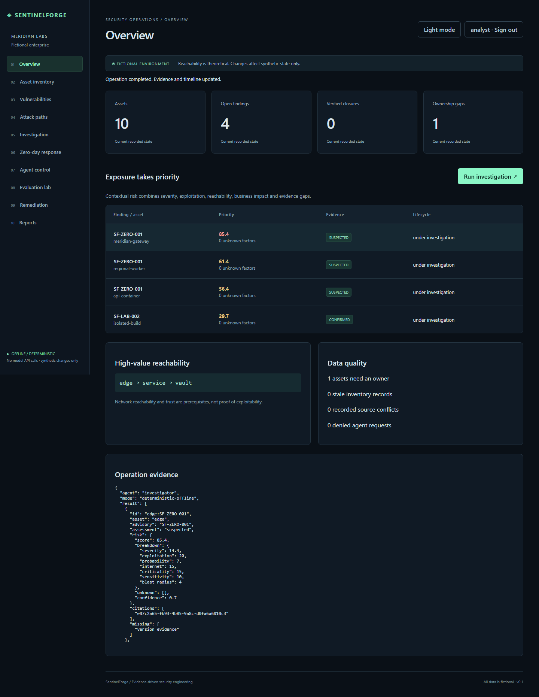
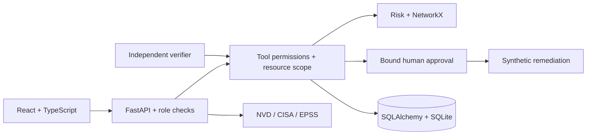
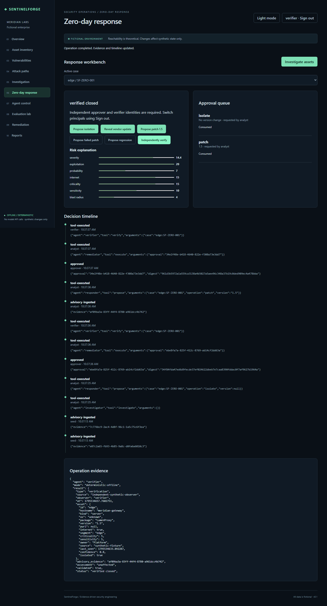

# SentinelForge

**Investigate exposure. Bound agent authority. Verify remediation.**

SentinelForge is an open-source security engineering demonstration combining contextual vulnerability prioritization, theoretical attack paths, an emerging-vulnerability response workflow and evidence-based closure. It uses a fictional enterprise and safe simulated changes throughout.

**Status: working offline MVP, not a production platform.** The full enterprise roadmap is unfinished. The browser workflow and policy tests run without an API key or commercial services. Optional live AI is a separately invoked, read-only fixture workflow; it has protocol tests but no measured live-model results.



## What works

- Ten fictional assets spanning endpoint, server, container, network, cloud, SaaS, identity, agent and sensitive-data types.
- JSON, CSV and CycloneDX component imports; stable-ID reconciliation, conflict retention, ownership and stale-data indicators.
- Transparent deterministic scoring and NetworkX reachability. A lower-CVSS exposed finding outranks a higher-CVSS isolated finding.
- Role-gated tools, scoped execution, kill switch, rate budgets, exact-action approvals, expiry, stale-state rejection and replay protection.
- Simulated isolation, patch, failed patch and regression; independent observer principal required for verification.
- React workspace with inventory, investigations, approvals, audit timeline, graph inspection and JSON evidence exports.
- NVD, CISA KEV and EPSS CVE import, plus OSV package client; bounded retries, source evidence, caching and OSV pagination.
- Optional OpenAI Responses API tool workflow over isolated synthetic data; fixed endpoint, bounded calls, structured output and citation-ID validation.

## Architecture



See [architecture and ADRs](docs/architecture.md), [threat model](docs/threat-model.md), [verification](docs/verification.md) and [limitations](docs/limitations.md).

## Quick start

Python 3.10 and Node 24 are the validated host runtimes. From the repository root:

```sh
python -m venv .venv
# Linux/macOS: source .venv/bin/activate
# Windows PowerShell: .\.venv\Scripts\Activate.ps1
python -m pip install -r requirements-lock.txt
npm ci --prefix frontend
npm run build --prefix frontend
# Linux/macOS:
SF_DEMO=1 uvicorn backend.app:create_app --factory --host 127.0.0.1 --port 8000
# Windows PowerShell instead:
# $env:SF_DEMO='1'
# python -m uvicorn backend.app:create_app --factory --host 127.0.0.1 --port 8000
```

Open [the local application](http://127.0.0.1:8000). It seeds the synthetic database automatically. No external service is used during the offline workflow. Login is disabled by default unless `SF_DEMO=1` or separate role passwords are configured.

Local-only demo principals: `analyst`, `approver`, `verifier`, `viewer`, `admin`. Each password is `local-demo-` followed by that principal, for example `local-demo-analyst`. These deliberately public credentials are for loopback synthetic demonstrations only. Tokens live in browser memory, expire after one hour, and are invalidated by logout or process restart.

### Docker Compose

```sh
docker compose up --build -d
```

Compose binds to `127.0.0.1:8000`, runs non-root with a read-only root filesystem and persists only its named demo volume. Docker was unavailable on the development host; **Linux CI validated the image build and Compose startup, frontend delivery, login and persisted investigation**. Local Windows Docker behavior remains untested. See [runbook](docs/runbook.md).

## Strongest demonstration: uncertain report to verified closure

1. Sign in as **analyst** and run the investigation. Inspect `edge:SF-ZERO-001`; the worker's unknown version and owner remain unresolved.
2. In **Zero-day response**, propose isolation. Sign out and use **approver** to approve the exact action.
3. Return as **analyst** and execute the simulation. It is pending verification, not closed.
4. Sign in as **verifier** and independently verify. Status becomes **mitigated** and the internet-to-vault path disappears.
5. As **analyst**, reveal the vendor update and propose patch 1.5. Repeat independent approval and analyst execution.
6. As **verifier**, verify software state. The case becomes **verified closed** with a timestamped evidence record.
7. To demonstrate failure, use a fresh demo database and propose the **failed patch** after revealing the vendor update. Verification reopens the case. A fresh approved regression after closure also reopens it.



[Scenario guide](docs/scenarios.md) maps all eight requested demonstrations to runnable tests and states what has not been measured.

## Tests and measured results

```sh
python -m pytest --cov=backend --cov=connectors --cov=agents
python -m ruff check backend connectors agents evaluations scripts tests
python -m bandit -r backend connectors agents scripts -q
python -m pip_audit -r requirements.txt
npm audit --prefix frontend
npm run build --prefix frontend
# With a fresh demo server running:
npx --prefix frontend playwright install chromium
npm test --prefix frontend
python -m evaluations.run
```

Measured on 2026-11-24: **46 Python tests passed**, **88% aggregate statement coverage**, **one Chromium end-to-end workflow passed**, TypeScript/build and Ruff passed, Bandit reported no findings, and pip-audit/npm audit reported no known vulnerabilities. These checks are bounded evidence, not certification. See [validation report](docs/validation.md).

The deterministic evaluation used 10 labeled assets: affected-or-suspected candidate precision/recall 1.0/1.0, 4/4 valid citation references, 0/6 unauthorized tool calls successful, 0/1 premature closure successful. These tiny synthetic samples do **not** measure real model prompt-injection resistance. [Machine-readable results](evaluations/results.json) and [methodology](docs/evaluation.md) distinguish this from live-model evaluation.

## Optional live intelligence and AI

```sh
python -m scripts.sync_public CVE-2021-44228
```

Public imports preserve raw responses but do not authorize simulator patches. Product correlation from NVD CPE data is not implemented. OSV is available as a Python client; see [API and connectors](docs/api.md).

For live model interpretation, set `OPENAI_API_KEY` in your shell and invoke `python -m agents.live --help`. Supply an available model and current conservative per-million input/output token prices. The command reserves a maximum estimated budget of $1 before starting, makes at most two Responses API calls, and shares only freshly seeded fictional data. Prices are operator-supplied estimates, not a provider billing guarantee. No model name or current price is guessed. [Official function-calling documentation](https://developers.openai.com/api/docs/guides/function-calling).

No API key was configured during development. Live model performance, actual cost and unconstrained-versus-hardened model comparisons are **not measured**. There are no live mutating agents or integrated chat UI.

## Security and responsible development

External advisories and model output are untrusted data. The model cannot grant itself tools, approve actions, supply verification observations or call arbitrary network destinations. App-level audit history is append-only, but a database administrator can alter it. Demo identities and shared infrastructure do not provide production separation of duties.

Implementation and tests were AI-assisted. [Engineering journal](docs/engineering-journal.md) records actual failures, corrections and review limitations without claiming human validation that did not occur. Read [SECURITY.md](SECURITY.md) before use. MIT license applies to original code; upstream dependencies and live public data retain their own licenses and terms. No third-party vulnerability feed is bundled.
