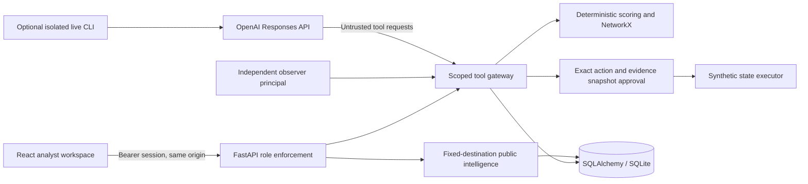

# Architecture and data model

The optional CLI owns a separate seeded state; it never reads the web application's inventory or sessions. The diagram shares the gateway implementation, not a network-accessible model execution path.

`backend/core.py` owns schemas, risk, matching, graph construction, reconciliation, approvals and lifecycle decisions. `backend/app.py` handles authentication, transport limits and imports. `connectors/public.py` implements fixed-host public clients. `agents/live.py` supplies an optional two-call, read-only model workflow. React displays persisted state and makes authenticated requests.

## Persistence

A single SQLAlchemy table stores a JSON snapshot with an integer revision. Compare-and-swap updates are transactional; concurrent stale writers fail instead of replaying an approval. This intentionally favors auditability of a small synthetic environment over throughput. SQLite is the validated storage engine. This is not a normalized enterprise relational schema or a tested PostgreSQL deployment.

The snapshot contains assets keyed by stable source IDs, advisories keyed by advisory IDs, immutable evidence entries keyed by UUID, cases keyed by asset/advisory pair, approvals, directed relationships, calls and audit events. An approval binds action digest, requester, expiry, asset digest and advisory digest; execution atomically marks it consumed. Audit events include actor, tool, safe arguments, timestamp and outcome. Failed tool authorization is recorded in a separate transaction so rejection rollback does not erase the denial.

## ADR 001 — one deployable process

Selected FastAPI + React + SQLite for a reproducible offline demonstration. PostgreSQL, a task queue, distributed sessions and normalized tables add operational costs without improving this fixture workflow. Revisit before concurrency, tenancy or external asset control. Sessions are process-local; run one worker.

## ADR 002 — simulation as authority boundary

The executor can isolate an asset or change a fictional version; it cannot run shell commands, contact assets or mutate third-party services. Independent verification reads simulator state rather than executor return values. This proves lifecycle invariants, not real scanner independence. Existing imported assets cannot overwrite simulated state; conflicts remain observations.

## ADR 003 — deterministic decisions and optional model interpretation

Scoring, connectivity, permission checks and closure remain deterministic. The optional live adapter supports five read-oriented agents over fixtures and validates output shape and referenced IDs. Model prose is not automatically verified truth. Mutating live agents and comparative model evaluation are deferred.
