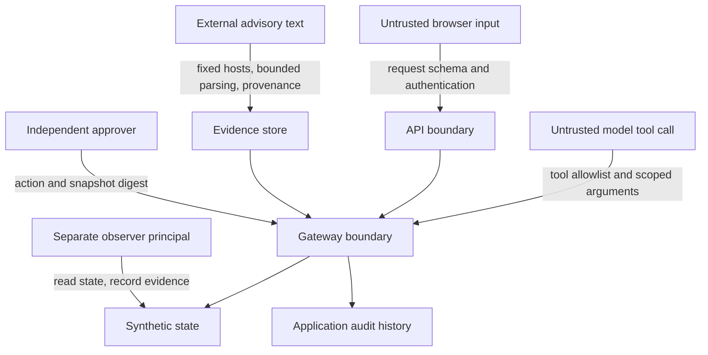

# Threat model and agent security

## Context, assets and assumptions

The app is a single-user-hosted, loopback-only synthetic laboratory. Security-relevant assets are session tokens, imported evidence, case state, action approvals and the audit trail. An optional model key exists only in the standalone CLI process environment and outbound authorization header. Public feeds and model output are untrusted. The operating-system account and database administrator are trusted; compromise of either defeats this application boundary.

## STRIDE analysis

| Threat | Implemented control | Residual risk |
|---|---|---|
| Spoofed analyst/agent | Server-issued random bearer sessions, role checks, agent allowlists | Public demo passwords, no MFA; anyone with host access can assume roles |
| Tampered approvals/evidence | Exact canonical action hash, asset/advisory snapshot binding, atomic consumed flag | Database administrator can rewrite all state; no signed evidence |
| Repudiated action | Timestamped actor/tool/result events; denied tools logged outside rollback | Logs are not cryptographically append-only or independently retained |
| Information disclosure | No secret-export tool, no arbitrary URL, memory-only browser token, fixed outbound hosts | All authenticated roles can read this single synthetic tenant; imported sensitive data would be visible |
| Denial of service | Request/response byte caps, request budgets, retry/page/call budgets, timeouts | State/audit growth, whole-document transactions, process-local limits; not internet-grade |
| Elevated privilege/confused deputy | Role and agent authorization outside model, independent approval and verification, immutable tool set | No real identity administration; standalone live CLI has its own demo state |

Direct or indirect prompt instructions cannot change the tool map, create approved actions or submit verification observations. A permitted read tool can still return attacker-controlled descriptions. The optional model may repeat misinformation or choose poor hypotheses; checking schema and citation existence does not establish correctness. Human semantic review is required.

## Guidance mapping and sources

Sources reviewed 2026-11-24. These are engineering mappings, not certification claims.

- [OWASP LLM Top 10, 2025](https://genai.owasp.org/llm-top-10/): LLM01 prompt injection maps to gateway policy and adversarial tool tests; LLM05 improper output handling maps to schema/citation-ID checks and React encoding; LLM06 excessive agency maps to restricted tools and exact human approval. Semantic misinformation remains a residual risk.
- [MITRE ATT&CK T1078, Valid Accounts](https://attack.mitre.org/techniques/T1078/): the service-identity-to-vault edge illustrates how trust and privileges can extend exposure. The graph does not prove account compromise or simulate credential theft.
- [MITRE ATLAS](https://atlas.mitre.org/): used as the AI adversarial-behavior reference for prompt manipulation and misuse scenarios. The technique page could not be verified during research, so no specific ATLAS technique identifier or coverage claim is asserted.
- [NIST AI RMF 1.0](https://www.nist.gov/itl/ai-risk-management-framework): documented assumptions, bounded measurement and explicit unmeasured live-model outcomes support risk governance; synthetic evaluations are evidence for this narrow workflow only. The official page states that 1.0 is being revised.
- [NIST SSDF 1.1 / SP 800-218](https://csrc.nist.gov/projects/ssdf): repeatable tests, dependency review, provenance and recorded corrections support secure development practices. ADRs and the threat model relate to PW.1.2 tracking requirements, risks and design decisions. No complete SSDF conformance assessment was performed.
- [Microsoft STRIDE guidance](https://learn.microsoft.com/en-us/azure/security/develop/threat-modeling-tool-threats): structures the abuse analysis above.
- [CISA KEV catalog](https://www.cisa.gov/known-exploited-vulnerabilities-catalog): known exploitation is a priority input and retained public source. Feed retrieval was live-tested; the website itself returned 403 during research. This project does not claim compliance with federal remediation deadlines.

## Review priorities

Review source trust and provenance, action digest/expiry semantics, transactional replay protection, independent verification assumptions, all model egress, and session lifecycle before extending the project. Real remediation tools need isolated executors, scoped credentials, independent signed observations and rollback controls before being enabled.
